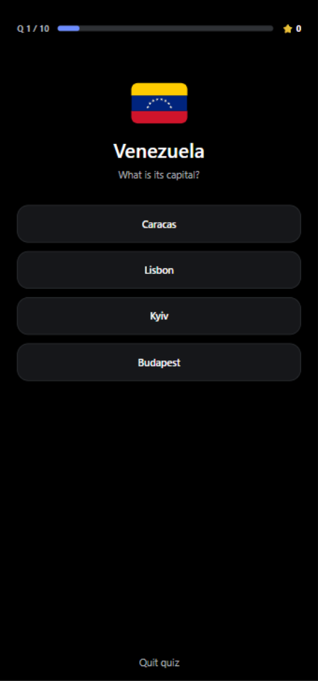
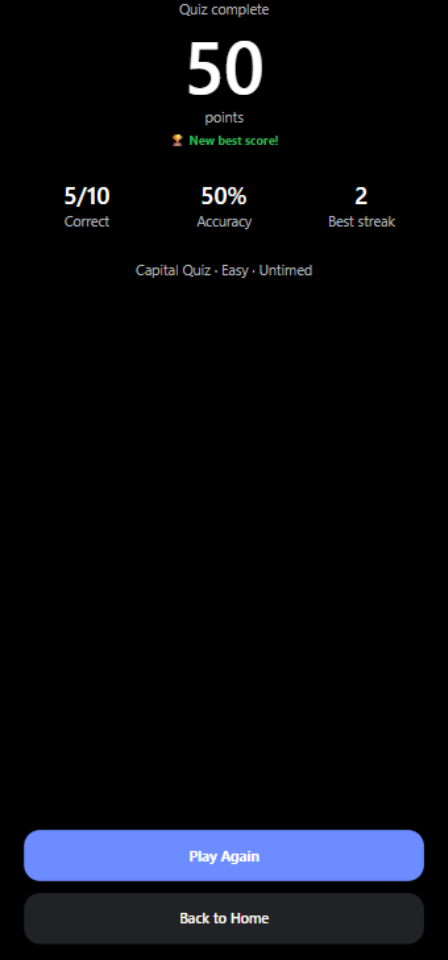

# Capital Quiz 🌍

A fast-paced geography quiz for Android, iOS, and web — guess the capital from a country name, or the country from its flag. Built with Expo, React Native, and NativeWind.

<p align="center">
  
  
  
</p>

## Features

- **Two game modes** — Capital Quiz (country → capital) and Flag Quiz (flag → country)
- **Three difficulties** — Easy, Medium, and Hard change the number of answer choices per question (4 / 6 / 8)
- **Optional timer** — 10, 20, or 30 seconds per question, or play untimed
- **Scoring, streaks & accuracy** — 10 points per correct answer with best-streak tracking and end-of-run stats
- **Personal bests** — best scores are saved on-device for each mode + difficulty + timer combination
- **71 countries** — emoji flags, spanning six continents

## Tech stack

- [Expo](https://expo.dev) SDK 57 / React Native with [expo-router](https://docs.expo.dev/router/introduction/) file-based routing
- [NativeWind](https://www.nativewind.dev/) — Tailwind CSS styling for React Native
- TypeScript with the React Compiler enabled

## Getting started

Prerequisites: [Node.js](https://nodejs.org/) and [pnpm](https://pnpm.io/) (npm or yarn work too — delete the lockfile first if you switch), plus an Android emulator, iOS simulator, or the [Expo Go](https://expo.dev/go) app on your phone.

```bash
pnpm install
pnpm start
```

Then scan the QR code with Expo Go, or press `a` / `i` in the terminal to launch on an Android emulator / iOS simulator. For web:

```bash
pnpm web
```

### Scripts

| Script | Description |
| --- | --- |
| `pnpm start` | Start the Metro dev server |
| `pnpm android` | Run on a connected Android device/emulator (dev build) |
| `pnpm ios` | Run on an iOS simulator (dev build) |
| `pnpm web` | Start in web mode |
| `pnpm lint` | Run ESLint |

## Project structure

```
src/
├── app/          # Screens, routed by expo-router (index, quiz, results)
├── components/   # Reusable UI (answer option, flag, progress/timer bars)
├── data/         # Country dataset (name, capital, flag, continent)
├── lib/          # Quiz logic: question generation, shuffling, scoring
└── store/        # Best-scores context persisted with AsyncStorage
```

## Contributing

Issues and pull requests are welcome! For larger changes, please open an issue first to discuss what you'd like to change.

## License

Released under the [MIT License](LICENSE).
